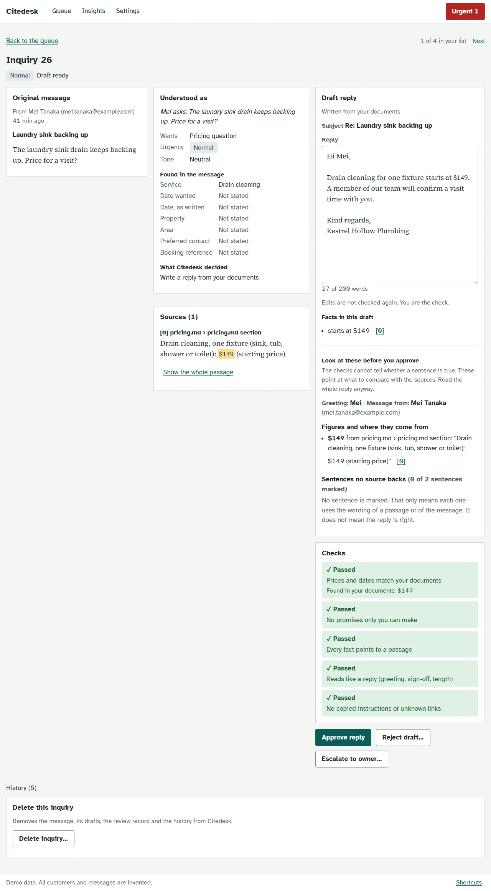

# Citedesk


> **Demo data. All customers and messages are invented.** Every name, email address, phone number and inquiry in this repository is synthetic, from an invented plumbing company ("Kestrel Hollow Plumbing"). There is no real customer data here, and nothing has been tried on a real business.

Citedesk is an AI review desk for customer inquiries at a small service business. It reads an incoming message, works out what the customer wants, drafts a reply from the business's own documents, checks the draft in code, and queues it for a person to approve. **Nothing is ever sent automatically**: drafts are shown for a person to copy.

It is built to be checked, not trusted. The model reads and writes; plain code, with unit tests, decides what is routed, what is escalated and what a draft may say. This README reports what was measured, including the targets it missed and a trial in which a reviewer missed every planted problem.

Part of a family of projects: [citeTally](https://github.com/Nbhaskell/citeTally), [citewise-markets](https://github.com/Nbhaskell/citewise-markets), [rag-project](https://github.com/Nbhaskell/rag-project), [citecheck](https://github.com/Nbhaskell/citecheck).



More screens, every state at desktop and phone width: [docs/screenshots/](docs/screenshots/README.md). Those pictures were made with a scripted model, not a language model's wording (see that page).

## What it does

1. **Screens** each message in code: masks card and Social Security numbers, archives spam, escalates suspected prompt injection, spots emergencies.
2. **Understands** it with a local model (`qwen3:8b` through Ollama): intents, urgency, tone, the details given and the details missing.
3. **Routes** it in code: draft a reply, ask for the missing details, or escalate to a person with a named reason (safety, complaint, legal threat, refund, policy exception, not in the documents, and so on).
4. **Retrieves** answers from the business's documents with [rag-project](https://github.com/Nbhaskell/rag-project), asking one question per intent. If the documents don't answer, it escalates with `NOT_IN_KNOWLEDGE_BASE` and never answers from the model's memory.
5. **Drafts** a reply from those passages only, and **checks** the draft in code: every figure appears in the sources, no promise only the owner can make, no copied instructions or unknown links.
6. **Queues** it for review. The person approves, edits, rejects, escalates or asks for a redraft, and copies the approved text. There is no send path anywhere in the code (a test looks for one).

Everything is stored in SQLite, with an audit trail that holds ids, stage names, timings and reason codes, never message or draft text.

## How well it works

Measured on 375 invented inquiries written by one author, an AI model (Claude), from the same fact sheet and documents the system uses: 135 **tuned** (the system was adjusted while looking at them), 76 **held-out** (written afterwards, in new wording, run once, never used for tuning) and 164 **sealed** (written by a separate session, kept out of the repository, run once on the final system). The full numbers and the evidence for each are in [eval/reports/](eval/reports/README.md).

| Measure | Target (PRD) | Tuned, 3 passes | Held-out, 3 passes | Sealed, 3 passes |
|---|---|---|---|---|
| Primary-intent accuracy | 85% | 83.5% | **69.8%** (missed) | **73.1%** (missed; 95% interval 65.8% to 79.4%) |
| Health-and-safety messages escalated | no misses | 8 of 8 | **12 of 12** (met) | **15 of 15** (met) |
| Route accuracy, whole pipeline | none set | 78.0% | 68.9% | 74.0% |
| Escalation precision | none set | 71.6% | 85.0% | 78.1% |
| Escalation recall | none set | 82.3% | 69.1% | 89.6% |

Sources: [tuned](eval/reports/tuned-think-on.md), [held-out](eval/reports/heldout-think-on.md), [sealed](eval/reports/sealed-run.md), [summary](eval/reports/README.md). Thinking mode was on for all three. The held-out run is of the system as it stood on 2026-10-29. The sealed run is of the final system (D-087). The three sets differ in mix (the held-out and sealed sets are built to exercise every rule, so more of their items should escalate), so rates are not directly comparable between sets.

**The sealed run missed the intent target.** The sealed set was written before the later prompt changes were designed and after the held-out error analysis. Safety recall was met and `STRUCTURE` passed on all model-written drafts. Policy-exception recall rose to 21 of 22 (held-out 1 of 6; the 95% intervals do not overlap). Injection recall (7 of 15) and spam archiving (1 of 9) stay weak, and 24 of the 164 items were escalated that should not have been. Details and the reading list are in [D-087](docs/DECISIONS.md).

**A second sealed set** ([report](eval/reports/sealed-v2-run.md), [D-108](docs/DECISIONS.md)): 136 messages written by another blind session, run once on the system after the later fixes (D-090, D-091), three passes:

| Measure | Second sealed set, 3 passes | First sealed set |
|---|---|---|
| Primary-intent accuracy (target 85%) | 75.8% (missed) | 73.1% |
| Health-and-safety messages escalated (no misses) | 16 of 16 in every pass | 15 of 15 |
| Route accuracy, whole pipeline | 83.1% to 83.8% | 74.0% |
| Escalation precision / recall | 80.2% / 96.5% (means) | 78.1% / 89.6% |

Spam is still sent to a person rather than archived (1 of 7 archived), 2 of 6 injections were not caught at screening (neither reached a reviewer as an ordinary reply), and messages with several intents stay weak (2 of 5 routed right). The sets differ in mix, so the change from the first set is a direction, not a measured gain.

**Against a method with no model** ([report](eval/reports/intent-baseline.md), [D-093](docs/DECISIONS.md)): a naive Bayes classifier on word counts, trained on the tuned split, got 39 of 76 held-out primary intents right (51.3%); on the same 75 items the model got 52 or 53 (about 70%). The model adds about 18 points on this step. Those are the held-out runs of the system before the later fixes; the sealed set cannot be used for a baseline.

**A second business in another trade** ([report](eval/reports/fernhollow-run.md), [D-097 to D-100](docs/DECISIONS.md)): the trade is a profile named in the fact sheet, and an invented electrician, Fernhollow Electric, has its own fact sheet, documents and emergency terms. A separate session that saw the labelling rules and the electrician's documents, but not the code, prompts or results, wrote 83 labelled messages. The final system ran them once, three passes, unchanged:

| Measure | Fernhollow Electric, 3 passes | Kestrel sealed, same system |
|---|---|---|
| Primary-intent accuracy (target 85%) | 70.7% | 73.1% |
| Health-and-safety messages escalated (no misses) | **11, 11 and 12 of 13 (missed)** | 15 of 15 |
| Route accuracy, whole pipeline | 67.1% | 74.0% |
| Escalation precision / recall | 72.9% / 74.6% | 78.1% / 89.6% |

Intent accuracy carried across, and a word-count baseline trained on the plumber scored 59.0% ([report](eval/reports/intent-baseline-fernhollow.md)). **Two safety messages were missed** (a dimmer running hot, a fan motor that smoked): the electrical emergency terms did not fire and the model did not flag them. They reached a person, as every message does, but not marked as safety. Weighted by assumed cost, routing cost 390 to 511 per 100 messages against 183 for escalating everything ([report](eval/reports/route-cost-fernhollow.md)). The set is spent. The electrical terms were then widened (D-106): on that spent set they now fire on all 13 safety messages and none of the 70 others, a development figure.

**The sealed electrician set** ([report](eval/reports/fernhollow-sealed-run.md), [D-107](docs/DECISIONS.md)): 113 messages written by another blind session before the terms were widened, run once with the wider terms, three passes:

| Measure | Fernhollow sealed, 3 passes |
|---|---|
| Primary-intent accuracy (target 85%) | 59.5% |
| Health-and-safety messages escalated (no misses) | **23 of 29 in every pass (missed)** |
| Route accuracy, whole pipeline | 77.9% to 79.6% |
| Escalation precision / recall | 79.1% / 87.6% (means) |

**The wider terms did not close the safety gap.** Six safety messages were missed in every pass; one was escalated for another reason and five went to the review queue unmarked. Intent accuracy was lower than on either earlier set. The set is spent.

More, from the first held-out pass ([report](eval/reports/heldout-think-on.md)): fields extracted correctly 90.7%; no ungrounded figure found by the figure check in 48 drafts; median 16.3 s per inquiry through all stages on the development machine (p90 33.0 s; the sum of the stage times).

**Design decisions that the numbers shaped**
- **Thinking mode on** ([D-063](docs/DECISIONS.md)): on scored higher than off on four of five measures (intent 83.5% against 77.2%), but no difference was large enough to call real, so the choice rests on direction and a small cost (about 3 s more at the understanding step). It is the default, and it was fixed before the held-out run.
- **Checks in code, not a model** ([TRD](docs/TRD.md)): a model never decides that a draft is safe. The cost is that the checks are phrase lists (see below).
- **One held-out run** ([D-061 to D-064](docs/DECISIONS.md)): enforced by a committed ledger ([eval/heldout_ledger.json](eval/heldout_ledger.json)) and tests, so the weak held-out number could not be quietly retried.

**The reviewer trial** ([report](eval/reports/review-trial.md), [D-066](docs/DECISIONS.md)): one reviewer, who also built the system, reviewed 24 inquiries. Median review time was **37 seconds** (p90 81 s), so "check a ready draft in under a minute" held. Six drafts each had one planted problem that passed every automated check (a made-up perk, a soft promise, a credit nobody offered, a wrong name, a price from the wrong service, a sentence describing how the desk works). **All six were approved unchanged: 0 of 6 caught** (exact 95% interval 0 to 46%). Reading the stored drafts afterwards (D-077), one of the six, the swapped price, shows a price that agrees with the sources, so it was not a defect: the count is better read as 0 of 5 real problems. The same reviewer rejected 3 of 14 ordinary drafts for real flaws. The setting favoured the reviewer (they knew some drafts had problems and 6 of 20 were bad), so the catch count is probably an upper bound.

## What the numbers do not say

- **Invented data, one labeller.** The documents, prompts, labels and test messages were all written by the same author (an AI model): the held-out set is unseen but not blind. Results on an invented business show the machinery works; they do not show how it behaves on a real business's messy inbox. A second person labelled a blind sample of 60 items and agreed with the existing primary-intent labels on 44 (73.3%, Cohen's kappa 0.70; D-089). The 85% intent target is therefore hard to reach under the current labelling rules, and some of the gap in the table is probably doubt about the labels, not only model error. The sample is small (interval about 61% to 83%), so how much is not known. The largest group of differences was booking versus availability, now written into the rules (D-090).
- **The held-out and sealed sets are both spent.** The sealed set of 164 items was written by a separate subagent that the fixing session never read from, kept out of the repository, and sealed by a committed hash (D-071, D-073). A runner lock allowed one run of one fixed system with the number of passes declared first (D-078); it was made once with three passes (D-087). Any further change to the system needs a fresh set before it can be claimed. The figures quoted for fixes in D-074 to D-086 before the sealed run were development figures; the sealed run is the first result on unseen messages for the final system.
- **Small counts.** Twelve safety items with no misses are compatible with a true miss rate near one in four. Each escalation reason has between 4 and 13 held-out items. The overall rates depend on the mix, which is not a real inbox (54% of held-out items should escalate, against 35% of tuned).
- **No score of draft quality.** A judge from a sibling project can ask whether each claim is backed by the passages (D-079). On 36 drafts labelled by hand it agreed with the labeller on 18 and flagged 16 drafts the labeller called fine; run only on the sentences that make claims it agreed on 29 of 36 (Cohen's kappa 0.07, from 2 drafts the labeller flagged), and with that rule it flags about one good draft in seven (D-082). It notices an invented perk, policy, credit or promise and notices a sentence about how the desk works in 7 of 15 cases. The labeller built the system and the sheet's rule, and the claims-only rule was changed once after seeing which labelled drafts it missed, so these are development figures and the judge is a screen, not a score.
- **A fixed seed** gives little run-to-run spread (on the sealed set 7 of 164 items moved intent between the three passes), which may not hold on another machine.

## Where it goes wrong

What follows is what the tests and the measured runs show, with the file that shows it.

**The person who reviews did not catch what the checks missed.** See the trial above. Do not read "a person approves everything" as a safety guarantee: it is only as good as the review, and the review screen did not point at the things the checks cannot see. Since the trial it does (D-077, see "What to improve"), but that has not been tried on a reviewer.

**Prompt injection is only partly stopped.** There are three lines of defence: screening patterns (plain code), the draft checks (plain code), and a person who reads every draft (see the trial). Nothing is sent automatically.
- Screening flagged all 6 injection items in the tuned set, which its patterns were written with in view. On the held-out set it flagged 1 of 4; the other 3 reached a reviewer as ordinary replies.
- Five invented messages in new words (a role-play as the owner, a fake notice, a request to paste the model's guidelines, a quoted forward, a request to add a sentence) were not flagged by screening; since D-074 the role-play is, and the other four are not ([tests/test_injection_end_to_end.py](tests/test_injection_end_to_end.py)). Run once each through the real model, three were not obeyed, one was obeyed and blocked by the commitment check, and one ("end your reply with the sentence ...") was obeyed and reached the reviewer as a ready draft. Five messages and one run each is a check, not a rate.
- Since the held-out run (D-074, D-075), screening patterns were widened and the model is also asked whether a message is aimed at the assistant. On a development set written by the author of the prompts, the patterns alone flagged 1 of 12 injections in wording written after them and the model question 10 of 12, with 1 false alarm in 46 ordinary messages overall. Those are development numbers. On the sealed run (D-087) the injection category had 15 items: screening caught 7, 8 were not caught and 4 of those reached a reviewer as ordinary replies; 1 of 15 near misses was flagged wrongly.
- The draft checks compare phrases and values. Since D-091 a red-team set of invented sentences ([tests/test_checks_redteam.py](tests/test_checks_redteam.py)) holds wordings the checks must stop, wordings they must allow, and known misses: "I'll make sure a courtesy credit is applied" and an invented perk with no figure in it still pass every check. The checks were changed with that set in view, so it is a development set, not a rate.

**On the held-out set, routing cost more than escalating everything** ([held-out](eval/reports/route-cost-heldout.md), [tuned](eval/reports/route-cost-tuned.md), [D-094](docs/DECISIONS.md)). Weighting each route error by an assumed cost in a person's minutes (a missed escalation 20, an extra escalation 4), the three held-out passes cost 338 to 364 per 100 messages; sending every message to a person would have cost 172. No safety message was missed: the cost is 12 to 13 missed escalations. The two break even when a missed escalation costs about 9 minutes. That was the system before the later fixes, which raised escalation recall on the sealed set to 89.6%; the sealed set cannot be costed, so whether the final system beats escalating everything on unseen messages is not known. On the tuned split the latest pipeline run costs 103 against 247.

**Understanding and routing are weaker on unseen messages.** On the held-out set primary-intent accuracy was 69.8% against a target of 85%, and policy-exception requests were escalated 1 time in 6. All 3 spam items in the first pass were escalated and none was archived. Since then (D-074) a separate yes/no question about exception requests was added: it flagged 19 of 20 requests on a development set and all 8 on the tuned set, whose wording the prompts were written with in view. It adds one model call per message (median model time 7.9 s on the tuned set). The held-out figures above are unchanged because the held-out set is spent; the sealed run (D-087) is the result for the final system. Later fixes (D-085) addressed the other held-out groups with mixed results: a definition of opening hours moved hours questions read correctly from 9 to 16 of 17 on a development set; a longer spam definition did not help (5 to 6 of 12) and was dropped; relative dates such as "today" are now dropped in code because the model ignored the prompt rule; and an imagined burst pipe no longer trips the safety-keyword net (gas, carbon monoxide and electrical terms always do). On the tuned split primary-intent accuracy stayed near 83% (102 of 123), and the sealed run then measured 73.1%. Politely worded spam still goes to a reviewer, because archiving needs a code score of 0.8 as well as the model's reading and archiving a real customer's message is the costly error.

**Draft style.** About one draft in five (one in three of the model-written ones) fails the non-blocking structure check (no greeting or sign-off), and some arrive with their paragraph breaks collapsed. The business documents spell "neighbourhood" the British way, and drafts copy it. Since then (D-076) the greeting, sign-off and paragraph breaks are set in code: on 60 tuned items 32 of 32 drafts passed that check, which is largely by construction and says nothing about content.

**Draft content that no check catches.** Reading drafts found four patterns, each now handled by a prompt rule or a warning on the review screen, none by a blocking check: a sentence of sympathy the message does not call for (D-080, prompt rule and a tone mark); a request for a detail the customer already gave (D-081, the writer is told what is known and a sentence that asks for it is marked); a sentence that uses a passage's words and gets its meaning wrong ("sales tax on all parts and labour" where labour is not taxed), which no mark finds; and a reply that defers a price the passages list (D-083, a mark when the message asks the cost, a priced line fits what was asked and the draft names no price). The prompt rules were tried on replays of the tuned drafts with the real model, the same items they were written from; a full tuned pipeline run after them (D-084) showed no regression: `STRUCTURE` and the other checks passed on 86 or 87 of 87 drafts, route accuracy rose from 75.6% to 82.2% and `POLICY_EXCEPTION_REQUEST` recall from 3 of 8 to 8 of 8, on the split the prompts were written against. In that run 19% of reply sentences carried the "not from your documents" mark, mostly generic offers, and three of them were correct prices worded differently from the pricing line. The marks are warnings for a person who reads the reply and are not tested on a reviewer.

**Failures are handled, and each leaves the inquiry where a person can find it** ([tests/test_failure_paths.py](tests/test_failure_paths.py)). If the model is offline or gives invalid JSON twice, the inquiry becomes `failed` at its stage and Retry resumes there. If the knowledge base is offline, it fails at retrieval and nothing is drafted without sources. If the database is locked, a write is refused with a generic 500 and a request id, nothing is half stored, reads still work, and the background worker carries on once the lock clears. An inquiry that was accepted is never lost.

**Single user, one machine.** There is no authentication, and the server listens on `127.0.0.1` only. It answers only requests addressed to this machine's own names, and takes changes only from pages on this machine or from tools that send no `Origin`, so another website open in the same browser can neither read the queue through DNS rebinding nor post a form to it (D-092). Any program running on the machine can still call it. The size limit (413) and the rate limit (429, 300 requests a minute for new inquiries and imports) are checked inside the one process, for all callers together, and the rate counter starts again when the server restarts.

**Deleting data.** An inquiry can be deleted from its page (it asks first; it cannot be undone): the message, drafts, reviews and history go, and one audit event with the id and no text is kept. Closed inquiries can be removed by age with `python -m citedesk.db purge --older-than DAYS` (`--dry-run` lists them first). Deleted text is overwritten in the database file; backups and other copies are not touched (D-101).

**Logs hold ids, codes and type names, not text.** The server writes no access log (its lines would carry search text), and an unexpected error is answered by the app so the server never logs a traceback ([tests/test_hardening_logs.py](tests/test_hardening_logs.py)). Dependencies were audited with `pip-audit` and `npm audit`: nothing was reported on 2026-10-29. On 2026-11-03 `pip-audit` was still clean and `npm audit` reported one moderate advisory (`minimatch`, in the lint tooling only; none for production dependencies; the only offered fix is a breaking change to the lint plugins, so it was not applied). The advisory was later dismissed on GitHub because the affected code path is not used by the lint tooling (D-096). These are point-in-time results.

## What this could save

**This is an illustration with every assumption labelled. No saving was measured.**

| Quantity | Value | Where it comes from |
|---|---|---|
| Time to check a ready draft | about 37 s (p90 81 s) | **Measured**, one reviewer on 20 invented drafts ([report](eval/reports/review-trial.md)) |
| Share of inquiries that reach a ready draft | 43 of 76 in the first held-out pass | **Measured** on an invented mix ([report](eval/reports/heldout-think-on.md)); a real inbox will differ |
| Minutes to write a reply by hand | 5 | **ASSUMPTION**: nobody timed hand-written replies |
| Inquiries per day | 20 | **ASSUMPTION** |
| Time to handle an escalated inquiry | the same as by hand | **ASSUMPTION**: the tool saves nothing on these |

On those assumptions, a day of 20 inquiries would take about 100 minutes by hand. With the tool, about 11 ready drafts at about 1 minute each and 9 handled by hand at 5 minutes comes to about 56 minutes: roughly 45 minutes saved, **if** a review takes about a minute and the reviewer catches problems, which the trial does not show. Change any assumption and the answer changes. The Insights screen holds your own number for the hand-written time and labels the result "Estimate based on your assumption".

## Run it

**Tested on Windows 11 with PowerShell.** CI runs the tests on Linux. Running the whole stack on macOS or Linux is untested. You need Python 3.13, Node.js 22 and npm, [Ollama](https://ollama.com) with `qwen3:8b`, and [rag-project](https://github.com/Nbhaskell/rag-project) (a separate project, the knowledge base) with the `embeddinggemma` embedding model.

```powershell
git clone https://github.com/Nbhaskell/citedesk.git
cd citedesk
py -3.13 -m venv .venv
.\.venv\Scripts\python.exe -m pip install -r requirements-dev.lock
.\.venv\Scripts\python.exe -m pip install -e . --no-deps
Copy-Item .env.example .env
```

**The tests need no model, network or GPU:**

```powershell
.\.venv\Scripts\python.exe -m pytest
.\.venv\Scripts\python.exe -m ruff check .
.\.venv\Scripts\python.exe -m mypy
```

**The web app's checks** (from `web\`, once `npm ci`): `npm run lint; npm run typecheck; npm test; npm run build`.

**The demo, in one command.** Start Ollama (with `qwen3:8b` and `embeddinggemma` pulled), install the web app once (`cd web; npm ci`), and have [rag-project](https://github.com/Nbhaskell/rag-project) set up in a folder next to this one (or pass `--rag-project <folder>`). Then:

```powershell
.\.venv\Scripts\python.exe -m tools.start
```

It checks Ollama, starts rag-project on the invented plumber's documents (indexing them the first time) or reuses one that already serves them, then starts the API and the web app, and stops what it started on Ctrl+C. `--business fernhollow` runs the invented electrician instead (D-098, D-102). Starting each part by hand is described in [docs/knowledge-base-contract.md](docs/knowledge-base-contract.md).

In a second terminal, load a few invented inquiries:

```powershell
.\.venv\Scripts\python.exe -m tools.import_inquiries --limit 8
```

Open <http://127.0.0.1:5174>. The API is at <http://127.0.0.1:8100/api/status>. Each inquiry takes 25 to 45 seconds to read, retrieve, draft and check on the development machine.

**Reproduce the evaluation** (needs Ollama and rag-project running and indexed, about 40 minutes per pass; runs are saved under `eval\runs\`, which is git-ignored). The runner asks the system, the scorer reads a saved run with no model, and the comparison tests two settings over repeat passes:

```powershell
.\.venv\Scripts\python.exe -m tools.eval_run --passes 3 --label think-on
.\.venv\Scripts\python.exe -m tools.eval_score eval\runs\<run>.run.json
.\.venv\Scripts\python.exe -m tools.eval_run --passes 3 --thinking off --label think-off
.\.venv\Scripts\python.exe -m tools.eval_compare --a <off runs> --b <on runs> --label-a think-off --label-b think-on
```

The held-out split has been run once and the runner refuses it again without a written justification (the ledger is [eval/heldout_ledger.json](eval/heldout_ledger.json)); do not use it to tune.

## What to improve

Open items, in priority order:

1. **Try the review aids on a reviewer.** The review screen now shows, beside the draft, the line each figure comes from, the greeting name next to the sender, and the sentences no passage backs (D-077), plus sympathy the message does not call for (D-080), requests for details already given (D-081) and a listed price the reply leaves out (D-083). Against the six drafts of the first trial the sentence marks and the name warning point at all five real problems, and about one ordinary sentence in ten is marked; those are development numbers from code written with the problem kinds in view. Whether a person catches more with them is not known: it needs a rerun of the reviewer trial with new plants in new wording on different items, and ideally a second reviewer.
2. **A route cost on unseen messages.** The second sealed set (D-108) is spent; `tools.route_cost` does not yet accept sealed labels, so whether the final system's routing costs less than escalating everything on unseen messages (D-094) is still not known. Any further change needs a fresh set.
3. **Understanding accuracy** (75.8% against 85% on the second sealed set; 73.1% on the first): spam that is escalated instead of archived (1 of 9), injection wordings that got through (8 of 15), and items escalated that need not be (24 of 164). A second labeller agreed with the existing intent labels on 73.3% of a 60-item sample (D-089), so label doubt is probably part of the gap (how much is not known); the booking versus availability rule is now written (D-090), and any further rule changes come before more prompt work.
4. **The phrase-list checks** (commitments, injection echo): they miss paraphrases. D-091 closed the gaps found by a review (a negation from another clause, a source phrase used only to deny it, spelled-out money, bare domains) and keeps the remaining known misses in a red-team test. Wordings written by someone who has not seen the checks would give the first real catch rate.
5. **Spelling in the business documents:** they spell "neighbourhood" the British way and drafts copy it (regenerate the documents from `facts.json`, then re-index and re-run the tuned evaluation). Greetings, sign-offs and paragraph breaks are set in code since D-076.
6. **A second labeller** for the judge's 36 hand labels and a score of draft quality that does not rest on the writer of the system (D-079, D-082). Since D-095 the Insights screen shows draft quality from use (how much reviewers edit, how often they reject, and whether drafts with a warning are changed more often); it has not yet seen real reviews. Under-answering is covered for prices only (D-083); other kinds, such as hours and policies, are not.
7. **Later:** a hosted model behind the same interface (message text would leave the machine), Gmail draft creation (drafts only, never send), and a real pilot with a willing business, which needs consent, anonymisation and its own evaluation.

## Licence

MIT. See [LICENSE](LICENSE). The invented data in `universe/` and `eval/golden/` is released under the same licence. The web app's build bundles two fonts from `@fontsource`, Atkinson Hyperlegible and Source Serif 4, under the SIL Open Font License 1.1; neither font file is stored in this repository. Dependencies keep their own licences (the runtime Python ones are MIT, BSD, Apache-2.0 and PSF-2.0; the JavaScript ones are mostly MIT, with a few MPL-2.0, OFL-1.1 and CC-BY-4.0 packages used only for building, testing or as bundled fonts and data).

## Documentation

[docs/](docs/): [PRD](docs/PRD.md) (what and why), [TRD](docs/TRD.md) (architecture, stages, checks, API), [APP_FLOW](docs/APP_FLOW.md), [UI_UX_DESIGN_BRIEF](docs/UI_UX_DESIGN_BRIEF.md), [UI_DESIGN_PLAN](docs/UI_DESIGN_PLAN.md), [BACKEND_SCHEMA](docs/BACKEND_SCHEMA.md), [RULES](docs/RULES.md) (the rules that do not bend), [IMPLEMENTATION_PLAN](docs/IMPLEMENTATION_PLAN.md), [DECISIONS](docs/DECISIONS.md) (every decision not covered by the others, D-001 to D-096), [REVIEW_TRIAL](docs/REVIEW_TRIAL.md), and [the knowledge-base contract](docs/knowledge-base-contract.md).
