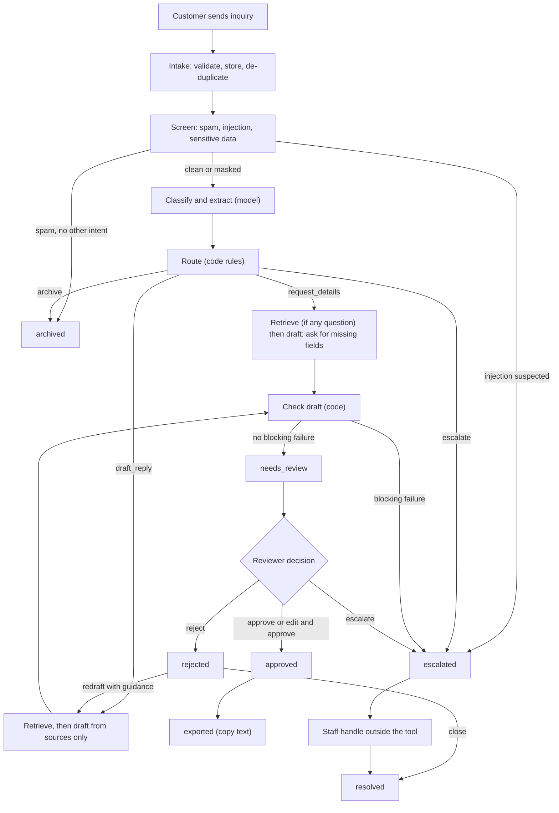
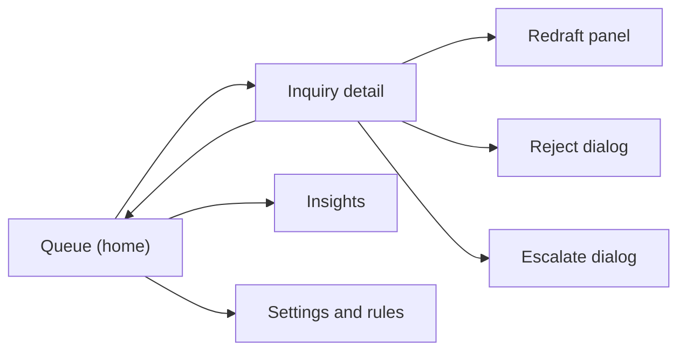

# Application Flow: Citedesk

Version 0.1. Uses the enum values and statuses from `BACKEND_SCHEMA.md`. Screens are described in `UI_UX_DESIGN_BRIEF.md`.

## 1. Actors

| Actor | Role |
|---|---|
| Customer | Sends an inquiry through a web form or email. Never uses the tool directly |
| Reviewer (front-desk staff or owner) | Works the queue, approves, edits, rejects or escalates |
| Pipeline | The background process that screens, understands, routes, drafts and checks |
| Knowledge base | `rag-project`, answers from the business's documents |
| Model | Local Ollama model that reads and writes text; never decides safety |

## 2. End-to-end flow

## 3. Status lifecycle

The authoritative transition table is in `BACKEND_SCHEMA.md` section 5. Summary:

`received` → `screened` → `classified` → `routed` → `drafted` → `needs_review` → `approved` → `exported`

Side exits: `archived` (spam), `escalated` (needs a person), `rejected` (reviewer said no; can be redrafted or `resolved`), `failed` (retry possible).

## 4. Flows in detail

### 4.1 Intake

1. A request arrives at `POST /api/inquiries`, the importer, or a webhook.
2. Validate required fields (`body` not empty, length limit, valid email format if present).
3. If an identical message from the same sender exists within the duplicate window, store a new row with `duplicate_of` set and stop; show it in the queue as a linked duplicate.
4. Write the inquiry with status `received` before any processing, so nothing is lost if a later stage fails.
5. Return `{id, status}` immediately; processing continues in the background.

### 4.2 Screening

1. Compute spam score, injection flags, and sensitive-data matches.
2. Mask sensitive values in the stored body; set `sensitive_data_masked`.
3. Result `spam` with no other signals: status `archived`, route `archive`.
4. Result `injection_suspected`: status `escalated`, reason `INJECTION_SUSPECTED`; the model never sees the message.
5. Otherwise status `screened`.

### 4.3 Understanding

1. The model returns classification and fields as JSON validated by schema.
2. Invalid JSON: retry once with the validation error; a second failure sets `failed` with `failure_stage = understand`.
3. The safety net in code scans for emergency terms; a hit raises urgency to at least `high` and adds the `HEALTH_SAFETY` reason even if the model missed it.
4. Code computes `missing_fields` from the required-fields table.
5. Status `classified`.

### 4.4 Routing (code)

Rules, in order: archive; escalate on any listed reason code; request details when required fields are missing; otherwise draft reply. All matching reason codes are saved, not just the first. Status `routed`, then the next stage starts or the inquiry waits in `escalated` / `archived`.

### 4.5 Retrieval and drafting

1. Build a standalone question from the inquiry; one question per intent when there are several.
2. Ask the knowledge base; keep sources.
3. If the knowledge base declines or returns nothing, add `NOT_IN_KNOWLEDGE_BASE` and route to `escalate`; a `holding_reply` draft may be offered, labelled as not grounded.
4. The model drafts from sources only; for `request_details` it asks only for what is missing.
5. Status `drafted`.

### 4.6 Checks

Run all checks and store each result. If any blocking check fails, the inquiry becomes `escalated` with `UNVERIFIED_FIGURE` (figures), `POLICY_EXCEPTION_REQUEST` (commitments) or `INJECTION_SUSPECTED` (injection echo), and the reviewer sees the draft marked as blocked, with the failed check explained. Otherwise status `needs_review`.

### 4.7 Review

1. The reviewer opens the queue (urgent and oldest first) and picks an item. A timer starts for `review_seconds`.
2. The detail view shows the message, the "Understood as" panel, the draft, sources, and checks.
3. Decisions:
   - **Approve:** draft marked `approved`, status `approved`.
   - **Edit and approve:** edited text saved in `reviews.edited_body`, then as approve.
   - **Reject:** reason required; status `rejected`; choose "Redraft" (with guidance) or "Close".
   - **Escalate:** note required; reason `MANUAL`.
4. After approve, the reviewer copies the text (status `exported`). Nothing is sent by the tool.

### 4.8 Escalated items

Escalated items appear in their own filter with the reason shown in plain words ("Mentions a gas smell, flooding or another safety risk"). Staff handle them outside the tool and press "Mark resolved" with an optional note. A drafted reply may exist but is labelled "for reference".

### 4.9 Failure and retry

A `failed` item shows the stage and a short reason, with a Retry button that restarts from the failed stage. Failures do not block other items.

## 5. Screen map and navigation

| Screen | Entry | Exits |
|---|---|---|
| Queue | App start | Detail, Insights, Settings |
| Inquiry detail | Click an item, or keyboard `Enter` | Back to queue, next or previous item (`j`, `k`) |
| Insights | Nav | Queue |
| Settings and rules | Nav | Queue |

## 6. Edge cases and expected behavior

| Case | Behavior |
|---|---|
| Message is empty or only attachments | Rejected at intake with a clear error; nothing stored |
| Message in another language | Classified normally if the model can; otherwise `LOW_CONFIDENCE` escalation. The draft replies in the customer's language only if the style guide allows it (default: English and escalate) |
| Two questions in one message | Multi-intent; one draft answers both when sources exist |
| Customer sends a card number | Masked before storage; warning shown; the draft tells them not to send payment details by email |
| Message pretends to be the owner or an instruction to the assistant | Screening flags injection; escalated; model never sees it |
| Question outside what the documents cover | Knowledge base declines; escalated with `NOT_IN_KNOWLEDGE_BASE`; no invented answer |
| Draft contains a price not in the sources | Blocked; escalated with `UNVERIFIED_FIGURE`; draft shown with the figure highlighted |
| Model times out | One retry without thinking; then `failed` with Retry |
| Knowledge base is offline | `failed` at retrieve; banner "Knowledge base unreachable"; nothing drafted |
| Reviewer closes the app mid-review | Nothing lost; timer discarded; item stays in `needs_review` |
| Same customer sends a follow-up | Linked by `thread_id` or sender; the earlier inquiry is shown in the detail view |
| Duplicate message | Linked to the original; no second draft |

## 7. Notification and timing behavior (v1)

No push notifications. The queue shows counts and the age of the oldest urgent item. The browser tab title shows the number of items needing attention. Email or chat alerts for urgent items are a later feature.

## 8. Data flow summary

| Stage | Reads | Writes | Event |
|---|---|---|---|
| Intake | request | `inquiries` | `status_changed` |
| Screen | `inquiries` | `screenings`, masks `inquiries.body` | `stage_finished` |
| Understand | `inquiries` | `classifications`, `extractions`, `escalations` | `stage_finished` |
| Route | classification, extraction, screening | `inquiries.route`, `escalations` | `route_decided` |
| Retrieve | inquiry, extraction | `retrievals` | `stage_finished` |
| Draft | inquiry, retrievals | `drafts` | `stage_finished` |
| Check | draft, retrievals, inquiry | `draft_checks`, `escalations` | `check_failed` when blocking |
| Review | draft | `reviews`, `exports` | `review_recorded` |
