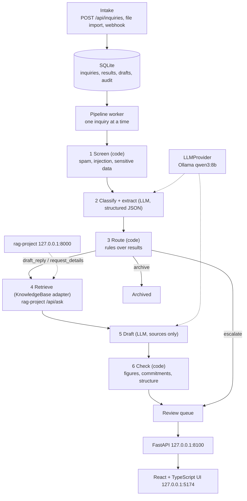

# Technical Requirements Document: Citedesk

Version 0.1. Companion to `PRD.md`. Names for intents, statuses, route values, reason codes and tables are defined in `BACKEND_SCHEMA.md` and must match exactly.

## 1. Architecture overview



Design principle carried over from `citewise-markets`: the model reads and writes; code decides, computes and checks. Routing, required fields, escalation, figure checks and commitment checks are plain code with unit tests. The model never decides whether something is safe to send.

## 2. Technology choices

| Area | Choice | Why |
|---|---|---|
| Language | Python 3.13 | Matches the author's other projects |
| API | FastAPI + Pydantic v2 | Typed request and response models, OpenAPI for generated front-end types |
| Database | SQLite (WAL mode), plain SQL migrations | Zero setup for a local demo, one file, portable SQL so Postgres is possible later |
| Model | Ollama, `qwen3:8b`, temperature 0 | Local and free; same model family as the other projects. Behind `LLMProvider` |
| Knowledge base | `rag-project` over HTTP behind `KnowledgeBase` | Reuses existing work; swap for another retriever without touching the pipeline |
| Front end | React + TypeScript + Vite | Same stack as `citewise-markets`; types generated from the OpenAPI schema |
| Tests | pytest; Vitest for the UI | Unit tests need no model or network |
| CI | GitHub Actions, tests only | Same pattern as the other projects |
| Packaging | Docker Compose optional; documented venv path first | The author develops on Windows 11 |

No LangChain or LlamaIndex. The pipeline is plain Python so every step that shapes an answer is visible.

## 3. Components

```
citedesk/
  citedesk/
    config.py            settings from env, defaults
    db.py                connection, migrations runner, helpers
    models.py            Pydantic models and enums (single source of truth for values)
    intake.py            validation, de-duplication, import
    screening.py         spam, injection, sensitive-data detectors
    understand.py        classification and extraction prompts, schema validation
    routing.py           route and escalation rules (pure functions)
    knowledge.py         KnowledgeBase interface, RagProjectKB, FakeKB for tests
    drafting.py          draft prompts, request_details template
    checks.py            figure, commitment, structure, injection-echo checks
    pipeline.py          orchestrates stages, state transitions, retries
    providers/           LLMProvider interface, OllamaProvider (HostedProvider later)
    api.py               FastAPI app and routes
    events.py            structured log helper (no message text)
  db/migrations/         numbered .sql files, append-only
  web/                   React app
  eval/                  golden sets, runner, scorer, reports
  tools/                 synthetic data generation and import scripts
  tests/
  docs/                  these documents
```

## 4. Pipeline stages

Each stage reads from and writes to the database, records an `audit_events` row, and advances `inquiries.status`. A stage can be re-run safely (idempotent writes keyed by inquiry id and stage).

### 4.1 Screen (code only)

- **Spam:** simple signals (link density, known spam phrases, no relevant content) producing a score; above a threshold the route is `archive`, unless the sender is a known customer.
- **Injection:** patterns for instruction-like text addressed to an assistant ("ignore previous", "you are now", "system prompt", requests to reveal rules, encoded blocks). A hit sets a flag and escalates the inquiry with reason `INJECTION_SUSPECTED` before any model reads it. The model never sees a flagged message, so there is no later override; a reviewer can release it manually.
- **Sensitive data:** card-like numbers (Luhn check) and government-ID patterns. A hit does not escalate. The value is masked (for example `**** **** **** 1234`) before the body is stored and before any model sees it, the screening row records `sensitive_data_masked = 1`, and the review screen shows a warning that the customer sent sensitive data and the draft should tell them not to send it by email. Sensitive data is a screening flag, not an escalation reason code. The authoritative lists of values are in `BACKEND_SCHEMA.md`.

### 4.2 Classify and extract (LLM)

- One call returns JSON matching a Pydantic schema: `intents` (list, each with confidence from low, medium, high), `primary_intent`, `urgency`, `sentiment`, `escalation_signals` (a list of `REFUND_OR_DISPUTE`, `LEGAL_THREAT`, `POLICY_EXCEPTION_REQUEST`; D-041), `fields` (see schema), `summary` (one sentence, internal).
- Use Ollama's JSON-schema output option where available; validate with Pydantic regardless; on validation failure retry once with the error appended; on a second failure mark `failed`.
- Prompt version string stored with the result (`understand-v1`).
- The message body is passed inside clearly delimited data blocks, and the system prompt states that text inside the block is data and not instructions.
- Temperature 0, fixed seed, token cap 1,500, timeout 120 seconds, one retry with thinking off (learned from stalled runs in `rag-project`).
- A keyword safety net runs in code beside the model: if the text contains emergency terms (for example gas smell, carbon monoxide, flooding, burst pipe, sewage, sparks, electric shock), `urgency` is raised to at least `high` and `HEALTH_SAFETY` escalation is added even if the model missed it.

### 4.3 Route (code only)

Order of rules (first match wins, but all matching reason codes are recorded):

1. Archive: spam score above threshold and no non-spam intent (and no escalation reason applies; a model that says spam alone, when screening does not, escalates with `LOW_CONFIDENCE`; D-038).
2. Escalate: any of `HEALTH_SAFETY`, `COMPLAINT`, `REFUND_OR_DISPUTE`, `LEGAL_THREAT`, `POLICY_EXCEPTION_REQUEST`, `INJECTION_SUSPECTED`, or `LOW_CONFIDENCE` (primary intent confidence is low). A commercial `property_type` also escalates, with `POLICY_EXCEPTION_REQUEST` (D-039).
3. Request details: intent is a booking-type intent and a required field is missing.
4. Draft reply: everything else.

Required fields per intent are a table in `routing.py`. Rules and thresholds are config values with defaults, not prompt text, so they can be tested.

### 4.4 Retrieve

`KnowledgeBase.ask(question) -> KBResult` where `KBResult = {answer, declined, sources: [{file, section, page, text}], raw}`.

- Build a standalone question from the primary intent and the extracted fields plus the customer's own question text. For multi-intent inquiries, ask one question per intent and merge sources.
- If `declined` is true or there are no sources, add reason `NOT_IN_KNOWLEDGE_BASE` and route to `escalate` with a short draft "holding reply" suggestion (optional, flagged as not grounded). `declined` is decided by the adapter, and live availability is never asked (D-045).
- Store the retrieved passages (`retrievals`) so the reviewer sees what the draft was built from.
- `RagProjectKB` calls `POST /api/ask` on `RAG_URL` (default `http://127.0.0.1:8000`). Confirm the request and response shape in `rag-project/guides/api.md` before coding and write one contract test against a recorded response.

### 4.5 Draft (LLM)

- Inputs: the cleaned inquiry, extracted fields, the retrieved sources, a short style guide (greeting, sign-off, length limit, tone), and the list of things the draft must not do.
- A `request_details` reply with nothing to answer, and the holding reply, are plain templates with no model (D-047).
- Instructions: answer only from the sources; if a source does not cover something, say a staff member will follow up on it; ask for the missing fields when route is `request_details`; never confirm a booking, quote a price not in the sources, offer a refund or discount, or give health advice.
- Output: JSON `{subject, body, claims: [{text, source_index}]}`. The `claims` list is internal, shown to the reviewer, and used by checks. Customer-facing text is `subject` and `body` only.
- Temperature 0.2 at most for style; token cap 800.

### 4.6 Check (code only)

| Check code | Blocking? | What it does |
|---|---|---|
| `FIGURES_GROUNDED` | yes | Every money amount, number, date and time in the draft body appears in the retrieved sources, the fact sheet, or the inquiry. Derived values (sum of two source numbers) are flagged as `derived` and shown, not blocked. Adapted from the figure and date check in `citecheck` |
| `NO_COMMITMENT` | yes | Pattern checks for confirmations of booking ("you're booked", "confirmed"), refunds, discounts, guarantees, medical advice. Patterns are configurable |
| `CLAIMS_HAVE_SOURCES` | no (warn) | Every claim in `claims` points to a source index that exists |
| `STRUCTURE` | no (warn) | Has greeting and sign-off, under the length limit, no internal jargon such as intent names or "according to the documents" |
| `NO_INJECTION_ECHO` | yes | Draft does not contain system-prompt text, reproduce quoted instructions from the inquiry, or contain URLs not present in the sources |
| `ADDRESSES_ASK` | no (warn) | Optional judge-based check; off by default and not used as a gate until calibrated |

A failed blocking check changes the route to `escalate` with reason `UNVERIFIED_FIGURE` (figures) or `POLICY_EXCEPTION_REQUEST` (commitments) and shows the draft to the reviewer with the failure highlighted, never as a ready draft.

## 5. Interfaces

```python
class LLMProvider(Protocol):
    name: str
    def generate_json(self, *, system: str, user: str, schema: dict,
                      temperature: float = 0.0, max_tokens: int = 1500,
                      timeout_s: int = 120, seed: int | None = 0,
                      think: bool = False) -> LLMResult: ...   # `think` added in Phase 4 (D-042)

class KnowledgeBase(Protocol):
    def ask(self, question: str, *, history: list[str] | None = None) -> KBResult: ...

class MailExporter(Protocol):          # later
    def create_draft(self, to: str, subject: str, body: str) -> str: ...   # returns draft id; never sends
```

## 6. HTTP API (v1)

Base `http://127.0.0.1:8100`. All JSON. Request and response models are Pydantic classes; the OpenAPI schema generates the web app types.

| Method and path | Purpose |
|---|---|
| `POST /api/inquiries` | Create an inquiry, returns id and status; processing starts in the background |
| `POST /api/inquiries/import` | Upload JSONL or CSV |
| `GET /api/inquiries` | List with filters `status`, `route`, `urgency`, `q`, cursor pagination |
| `GET /api/inquiries/{id}` | Full detail: message, screening, classification, extraction, escalations, retrieval, latest draft with checks, history |
| `POST /api/inquiries/{id}/reprocess` | Retry a `failed` inquiry from the stage that failed (no body; D-051) |
| `POST /api/drafts/{id}/approve` | Body: optional `edited_body`; records review |
| `POST /api/drafts/{id}/reject` | Body: `reason` |
| `POST /api/drafts/{id}/redraft` | Body: `guidance`; writes the next draft version in the request and checks it (D-051) |
| `POST /api/inquiries/{id}/escalate` | Manual escalation with note |
| `POST /api/inquiries/{id}/resolve` | Close an escalated item handled outside the tool |
| `GET /api/drafts/{id}/export` | Returns approved text for copying |
| `GET /api/insights` | Aggregates |
| `POST /api/status/check` | Ask the model server and the knowledge base now; the result is remembered and shown by `GET /api/status` (D-053) |
| `GET /api/settings` | Read-only: business details, draft word limit, model, data mode, escalation rules and who sets each (D-053) |
| `GET /api/status` | Model, knowledge base and database health, synthetic-data flag |

Errors use one shape: `{ "error": { "code": "...", "message": "...", "request_id": "..." } }`. Every response, errors included, carries the same id in an `X-Request-ID` header.

Limits on intake (Phase 8, `citedesk/guards.py`): a request body over `MAX_BODY_CHARS * 6 + 64 KB` (5 MB for the import) is refused with 413 `payload_too_large` before it is read in full, whether or not it declares its size; more than `INTAKE_RATE_LIMIT_PER_MINUTE` calls to `POST /api/inquiries` and `POST /api/inquiries/import` in any 60 seconds are refused with 429 `rate_limited` and a `Retry-After` header. Reading is never limited.

## 7. Configuration

Environment variables with defaults in `.env.example`: `CITEDESK_DB_PATH`, `CITEDESK_PORT=8100`, `OLLAMA_URL`, `LLM_MODEL=qwen3:8b`, `RAG_URL`, `ESCALATE_ON_LOW_CONFIDENCE=true`, `SPAM_THRESHOLD`, `INTAKE_RATE_LIMIT_PER_MINUTE=300` (0 turns it off), `DRAFT_MAX_WORDS`, `ENABLE_THINKING=true` (v1 started with it off for speed; the tuned comparison favoured on but could not prove it, so on is the default from D-063; the understand step only, the retry never thinks), `SYNTHETIC_DATA=true`.

## 8. Security and privacy

- Bind to `127.0.0.1`. No authentication in v1; documented as single-user and local. Do not expose it to a network without adding authentication.
- The model output is treated as untrusted text: rendered as text in the UI, never as HTML, never executed, never used to build file paths, queries or URLs.
- Inquiry bodies are untrusted: they cannot change rules or routes. Screening, routing and checks are code.
- Logs and events record ids, stage names, timings, route and reason codes. No message text, draft text, names or emails.
- Database file and any real data are git-ignored. Test and demo data are synthetic and marked.
- Hosted-model mode, if added, sends message text to the provider; the README and the status endpoint must say so.
- Dependencies pinned with lock files; vulnerability audit before publishing; secret scan on the history.

## 9. Observability

Structured JSON events: `stage_started`, `stage_finished`, `stage_failed`, `route_decided`, `check_failed`, `review_recorded`, each with `inquiry_id`, `stage`, `duration_ms`, `request_id`. The `audit_events` table stores the same facts for the reviewer-facing history. A `/api/status` page reports last successful model call and queue depth.

## 10. Testing strategy

- **Unit (no model):** routing rules, required fields, screening patterns, every check, state machine transitions, API validation, migrations apply cleanly from empty.
- **Contract:** one recorded response from `rag-project` replayed against `RagProjectKB`; one recorded Ollama JSON reply.
- **Integration with fakes:** pipeline end to end with `FakeLLM` and `FakeKB` covering each route, each failure, and idempotent re-runs.
- **UI:** component tests for the four states (empty, loading, error, refusal) on each screen, and keyboard flow for review.
- **Evaluation (needs the model):** golden-set runs measured and reported, not asserted in CI.

## 11. Evaluation design (summary; follow the `qa-eval-harness` conventions)

- Golden set `eval/golden/citedesk_v1.json`: at least 150 synthetic inquiries across all intents, multi-intent, vague, urgent, angry, spam, out-of-scope, follow-up and injection attempts. Each item records labels: `intents`, `primary_intent`, `urgency`, `fields`, `should_escalate`, `expected_reason_codes`, `answerable_from_docs`, `split`.
- Splits: `tuned` and `heldout` (about one third), the held-out set written after the first prototype and run once before tuning.
- Runner and scorer are separate; each run records commit, settings, model, prompt versions, golden hash.
- Metrics: intent accuracy and macro-F1, urgency accuracy, field accuracy, escalation precision and recall by reason, route accuracy, draft check pass rates, ungrounded-figure count, injection outcomes, latency.
- Judge-based draft quality is optional and, if used, calibrated against hand labels with a known-bad check before being reported.
- Report includes a "what this cannot tell you" section.

## 12. Performance and capacity

Single reviewer, tens to low hundreds of inquiries per day. One pipeline worker processes a queue serially; the local model is the bottleneck. Queue depth and median time are shown in `/api/status`. No horizontal scaling in v1.

## 13. Error handling

- Model timeout or invalid JSON: retry once, then `failed` with `failure_stage` and `failure_message`; shown in the UI with a "Retry" button.
- Knowledge base unreachable: mark `failed` at the retrieve stage; never draft without sources.
- Duplicate submission (same sender, subject and body within a window): link to the existing inquiry instead of creating a new one.
- Database errors: surface a clear 500 with request id; never lose a received inquiry (write the inquiry before any processing).

## 14. Open technical questions

1. Does `rag-project` expose enough structure in `/api/ask` (file, section, passage text) to fill `sources`? If not, add a small endpoint there.
2. Is Ollama's JSON-schema `format` reliable with `qwen3:8b` at the chosen schema size? If not, simplify the schema or split classification and extraction into two calls.
3. Do thinking-mode and non-thinking mode differ meaningfully on classification accuracy? Measure in the first evaluation.
